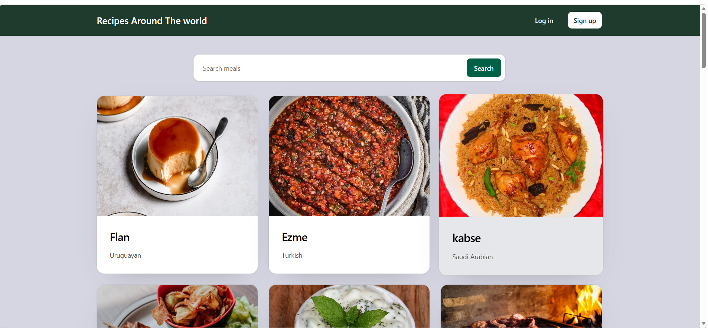

# Recipe Sharing Website

A full-stack website for discovering and sharing recipes. Users can create accounts, browse published recipes, and submit their own recipes. Administrators review submissions and decide which recipes appear on the website.

## Project Overview
**Live Demo:** [Meals App](https://sohaila-kandil.alwaysdata.net/)

The website has two main roles:

- **User:** browses recipes and submits recipes for review.
- **Admin:** manages the website’s recipe submissions and approves recipes for publication.

A submitted recipe is reviewed before it becomes publicly visible. This helps keep the published recipe collection organized and appropriate for visitors.

## Features

### User features

- Create an account and log in securely.
- Browse and read published recipes.
- View recipe details, such as ingredients and preparation steps.
- Submit a recipe with details such as:
  - Recipe name
  - Description
  - Ingredients
  - Preparation instructions
  - Category
  - Image, when available
- See whether a submitted recipe is awaiting review, approved, or rejected.

### Admin Features

Administrators have access to a dedicated dashboard where they can manage recipe submissions and published content.

- **View Submissions:** Browse recipes submitted by users.
- **Review Recipes:** Inspect recipe details before making a decision.
- **Approve Recipes:** Approve submissions to make them publicly available.
- **Reject Recipes:** Reject submissions that do not meet the website's requirements.
- **Manage Published Recipes:** Manage the collection of approved and published recipes.

### Admin Demo Account

To explore the admin features, log in using the following administrator account:

| Field | Credentials |
|---|---|
| **Email** | `abdul@gmail.com` |
| **Password** | `m1h2s3a4e5*` |

## How Recipe Approval Works

1. A user signs in and fills out the recipe submission form.
2. The submitted recipe is marked **Pending**.
3. An administrator reviews the recipe.
4. The administrator either:
   - **Approves** it, making it visible in the public recipe collection, or
   - **Rejects** it, keeping it off the public recipe collection.
5. Users can check the status of their submissions.

Only approved recipes are shown as published recipes to general visitors.

## Typical User Journey

1. Open the website and browse published recipes.
2. Create an account or log in.
3. Open the recipe submission page.
4. Enter the recipe information and submit it.
5. Wait for an administrator to review it.
6. Check the submission status later.

## Typical Admin Journey

1. Log in using an administrator account.
2. Open the recipe review area.
3. Select a pending submission.
4. Review the ingredients, instructions, and other details.
5. Approve or reject the submission.

## Technology

- **Frontend:** React, Vite and TailwindCSS
- **Backend:** Laravel
- **API:** Laravel REST API
- **Authentication:** Laravel Sanctum
- **Database:** SQLite.

  
## Deployment

The project is hosted on  [**Alwaysdata**](https://www.alwaysdata.com/en/)  

- **Frontend:** React.js (Vite)
- **Backend:** Laravel (PHP)
- **Database:** SQLite
- **Hosting:** Alwaysdata

The React application is built and deployed inside Laravel's `public` directory. Laravel handles API requests, user authentication, and database operations.

**Live Demo:** [Meals App](https://sohaila-kandil.alwaysdata.net/)
